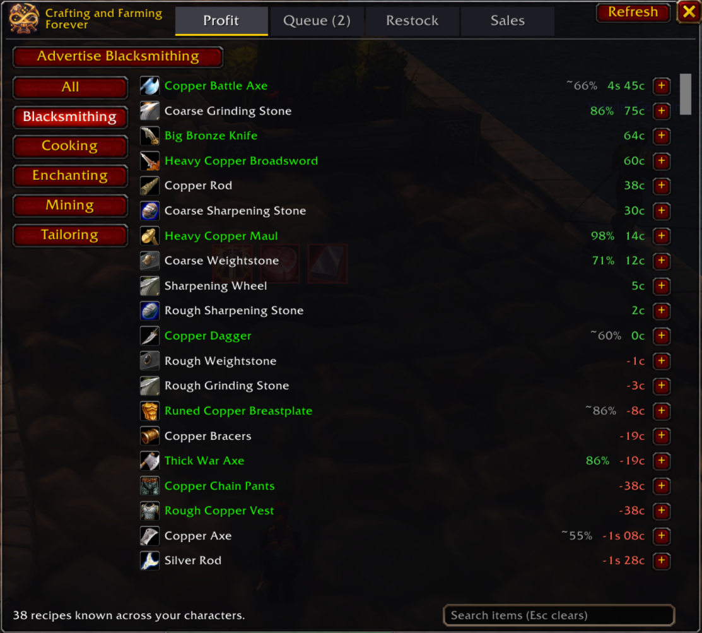
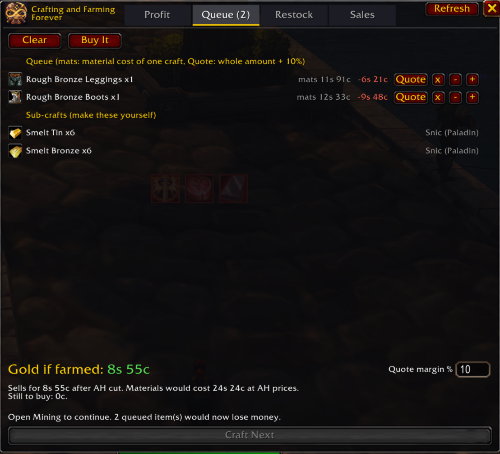
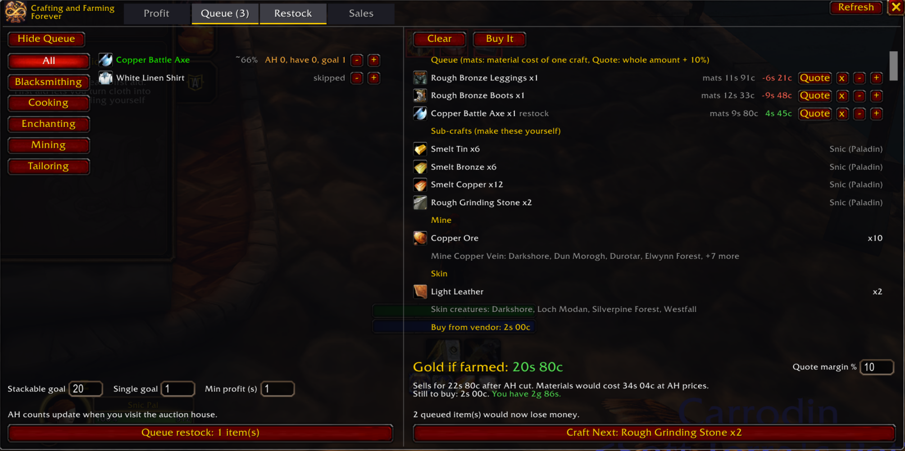
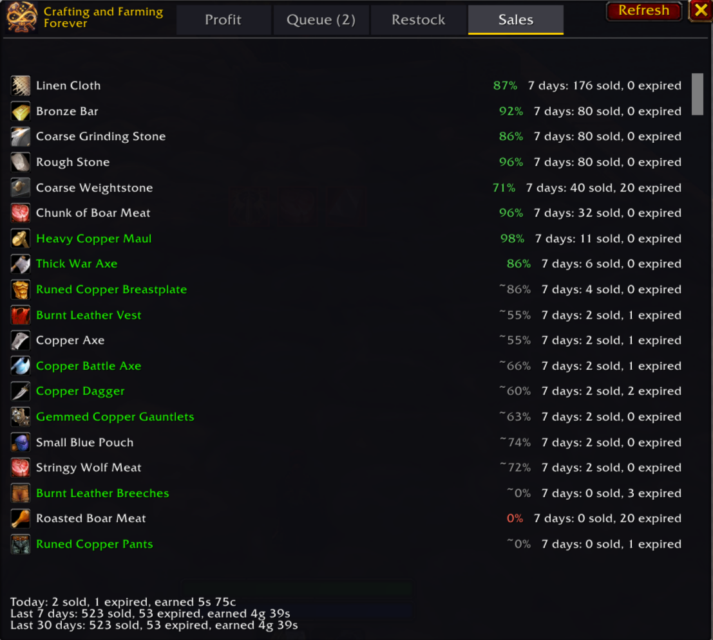

# Crafting and Farming Forever

A crafting add-on for **World of Warcraft: Forever**. It shows what's worth crafting, keeps one craft queue for all your characters, works out what you still need to buy or gather, and helps you keep the auction house stocked.

> **Needs [Auctionator](https://www.curseforge.com/wow/addons/auctionator) and [Syndicator](https://www.curseforge.com/wow/addons/syndicator).** It won't work properly without both: Auctionator supplies every price and the shopping list, and Syndicator counts what your alts hold and what you have on the auction house. **TradeSkillMaster (TSM) support is coming.**

- **Profit:** every recipe any of your characters knows, ranked by profit at current Auctionator prices, with a search box, a tab per profession, sorting by name, sell chance or profit, and an option to hide unprofitable recipes.
- **Skill up:** a levelling view of the same list: the recipes that can still give a skill point, cheapest per point first, coloured orange, yellow and green as in the game.
- **Cheapest path:** each material is costed as the cheapest of the auction house, a vendor, or crafting it yourself. Materials you already hold count as free.
- **Queue:** one queue shared by all your characters, planned per character (each one buys and crafts only its own part, then you're told to log in to the next), with total profit, what's still to buy, what to take from the bank, and a **Craft Next** button that doubles as a progress bar with the time left on your crafts.
- **Next step bar:** while anything is queued, a small bar at the top of the screen shows the next thing to do, with Craft Next when it's time to craft. Fold it to one line; it goes away when the queue is empty.
- **Live shopping list:** one Auctionator list, `Crafting and Farming Forever Queue`, holding only what you still need after your bags, bank and (with Syndicator) your alts' bags and banks. It's edited in place as things change, and what you buy leaves it at once (it counts as waiting in your mailbox). Find it in the auction house's **Shopping** tab.
- **Farm It:** turns the queue into a gathering list: which vein or herb, which zones, which creatures, what to disenchant. The Next step bar at the top of the screen walks you through it and counts down as you gather.
- **Restock:** a goal per item for how many you want on the auction house. One button queues the difference.
- **Restocking at the auction house:** a tab beside Auctionator's that lists what you can post from your bags, suggests the lowest listing's price, and posts it.
- **Sales:** what sold and what expired, read from your auction house mail, with each item's chance of selling within 24 hours.
- **Changelog:** a tab listing what changed in each version. It lights up after an update; nothing pops up.
- **Advertise and quote:** post a profession link to Trade, Guild, Say or Yell in one click, and reply to a whisper with a price for the whole order, at a margin you set.

## Screenshots

**Profit**: every known recipe ranked by profit, with each item's chance of selling.

**Queue**: the shared queue with its sub-crafts, profit and quotes.

**Restock beside the queue**: goals on the left; on the right, the queue in Farm It mode, with where to mine and skin what's missing.

**Sales**: what sold and expired per item, from your auction house mail, with each item's chance of selling within 24 hours.

## Requirements

| Add-on | |
| --- | --- |
| [Auctionator](https://www.curseforge.com/wow/addons/auctionator) | Required. Prices and the shopping list. Without it the add-on doesn't load. |
| [Syndicator](https://www.curseforge.com/wow/addons/syndicator) | Required to work properly. Alts' bags and banks, and what's on the auction house. Without it the add-on still loads, but it only counts the logged-in character's stock (so it may tell you to buy what an alt already has), the Restock tab is off, and it warns you in chat at each login. |

Coming soon: support for [TradeSkillMaster](https://www.curseforge.com/wow/addons/tradeskill-master) (TSM).

## Installation

1. Install Auctionator and Syndicator.
2. Copy the `CraftingAndFarmingForever` folder into `World of Warcraft/_forever_/Interface/AddOns/`. Only the `.toc` and `.lua` files are needed.
3. Restart the game client. A newly added add-on isn't picked up by `/reload`.
4. Log in to each character with a profession and open that profession once, so its recipes are recorded.

Upgrading from **CraftLedger**, the add-on's old name? With the game closed, run `tools/migrate-name.sh` to carry your saved data over and remove the old folder. See [the user guide](docs/USER_GUIDE.md#upgrading-from-craftledger).

## Quick start

1. Open a profession. The window opens beside it on the **Profit** tab.
2. If prices are more than a day old, it asks for a new auction house scan. Say yes when you're at the auction house.
3. Pick something profitable and press **+** on its row (Shift for 10, right-click to type an amount), or **Queue** under the favourite star on the recipe page, which queues the amount in the craft-count box.
4. At the auction house, open Auctionator's Shopping tab and search the `Crafting and Farming Forever Queue` list. It only holds what you still need.
5. Back at the profession window, press **Craft Next** until the queue is empty.
6. At the auction house, open the **Restocking** tab and post what you made.

## Commands

| Command | What it does |
| --- | --- |
| `/cff` or `/craftfarm` | Show or hide the window |
| `/cff profit`, `queue`, `restock`, `sales`, `changelog` | Open that tab, or close the window if that tab is already showing |
| `/cff next` | Fold or unfold the Next step bar |
| `/cff minimap` | Hide or show the minimap button |
| `/cff refresh` | Re-read recipes, stock and prices (the Refresh button) |
| `/cff advertise` | Advertise the selected profession in the chosen channel |
| `/cff clear` | Empty the queue |
| `/cff auto` | Toggle opening with the profession window |
| `/cff changelog` | Open the Changelog tab |
| `/cff diag` | Print diagnostics and save them for troubleshooting |

## Documentation

- [User guide](docs/USER_GUIDE.md): every tab and button, how prices and stock are worked out, and troubleshooting.
- [Development](docs/DEVELOPMENT.md): code layout, tests, deployment, regenerating the source data, and releases.

## Credits

Crafting and Farming Forever is built on other people's work. Thank you to:

- **[Auctionator](https://www.curseforge.com/wow/addons/auctionator)** by plusmouse and Borjamacare. All prices, the price history and the shopping list come from Auctionator, and the Restocking tab sits in the auction house through its [LibAHTab](https://github.com/Auctionator/LibAHTab) library. Crafting and Farming Forever calls Auctionator's public API while the game runs. Auctionator is All Rights Reserved, and none of its code is included here.
- **[Syndicator](https://www.curseforge.com/wow/addons/syndicator)** by plusmouse. What your alts hold in bags and banks, and what you have on the auction house, comes from Syndicator's public API. None of its code is included here.
- **[AllTheThings](https://github.com/ATTWoWAddon/AllTheThings)** by Crieve and the AllTheThings team. Farm It's list of where each material comes from (`Sources.lua`) is generated from AllTheThings' data under its MIT License.

See [THIRD-PARTY-NOTICES.md](THIRD-PARTY-NOTICES.md) for the licenses.

World of Warcraft and Blizzard Entertainment are trademarks or registered trademarks of Blizzard Entertainment, Inc. This project isn't affiliated with or endorsed by Blizzard Entertainment.

## License

All Rights Reserved. You may download the add-on, use it in World of Warcraft and read its source code. Copying, modifying or re-uploading it, in whole or in part, needs written permission from the author. See [LICENSE](LICENSE).

The AllTheThings data in `Sources.lua` keeps its own MIT License; see [THIRD-PARTY-NOTICES.md](THIRD-PARTY-NOTICES.md).
